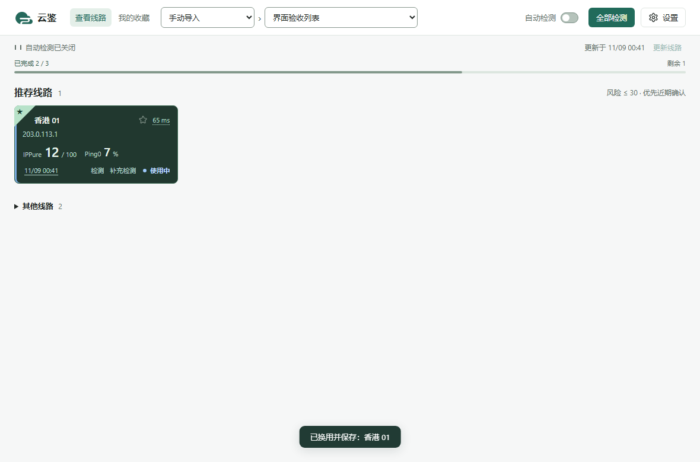

# 云鉴 · Yunjian

独立的 Windows 桌面应用，用来检查 Clash / Mihomo 线路的**连通性、出口 IPv4 和 IP 风险**。自动读取客户端中的线路列表，帮助找到符合地区与风险要求的线路。

检测使用独立 Mihomo 进程，不自动切换 Clash 当前线路，不修改系统代理、DNS 或路由。只有主动点击“换用”时，才由 Clash 官方界面切换并保存所选分组的线路。



*截图中的线路与 IP 均为测试数据。当前源码版本为 0.2.9，更新内容见 [CHANGELOG.md](CHANGELOG.md)。*

## 功能

- 自动发现 Clash Verge / Clash Verge Rev 的订阅，默认接入当前使用的订阅。
- 自动更新订阅，新节点和配置变化后重新检测；也支持手动检测与排队。
- 显示当前订阅的已完成 / 剩余 / 失败数量、检测阶段、单节点耗时与运行状态动画。
- 先检查连通性，再查询出口 IPv4 和 IPPure 风险，分别显示失败阶段。
- 推荐线路按地区、风险上限筛选，全部展开；其他线路默认收起。近期确认的线路优先，同分看历史，不按速度排序。
- 旧评分不会到期消失：超过一天标记“待复查”，不标首选；连接通过但评分查询失败时保留原评分与日期，标记“评分待更新”。
- 连接未确认、配置已变或已发现新的出口 IP 而未取得评分时，暂不推荐；旧结果仍可在记录中查看。
- 每条线路保留最近 10 次检查，显示 IP 变化和风险变化。
- 右键卡片或点星标即可收藏；“我的收藏”集中查看不同列表的线路。
- IP 变化会持续提醒并展示旧 IP → 新 IP，直到点击“已知晓”；历史仍保留。
- 点击卡片右上角的毫秒数只复测延迟，不覆盖 IP 或风险评分。当前选用的线路只显示一次“使用中”。
- Ping0 补测上次取得的 IPv4：正常网页直接解析，遇验证打开普通浏览器，由扩展自动回填并独立保存最近 10 次历史。
- 卡片一键换用线路：由固定的 Windows 程序调用 Clash 官方界面完成选择与保存，同时核对当前线路和保存记录；代理组选择在“其他节点”内。
- 链接或 YAML 导入后可以独立工作，不要求 Clash 持续运行。

| 默认计划 | 间隔 |
| --- | --- |
| 线路列表更新 | 24 小时 |
| 所有已启用列表的线路复查 | 24 小时 |

进度按每天的检测周期统计：本周期成功和失败均计入已完成，待重测、配置变化或手动复检计入剩余。这与历史评分是否保留无关。

应用打开时运行，可以最小化；退出后停止，下次打开继续。检测按顺序执行，不做大流量下载测速。暂停自动检测不会取消手动队列。IPPure 限流或拒绝查询时等待 30 分钟，冷却时间跨重启保留。

右上角“自动检测”开关控制后续定时任务，本次检测完成后仍可保持开启。关闭后当前节点会完成检测，不再启动新的自动任务；“全部检测”仍可手动运行。

## 自动检测与手动检测

顶部下拉框决定**正在查看哪个列表**；“设置 → 线路管理”中的勾选决定**哪些列表参加自动检测**。两者互不改变。

| | 自动检测 | 手动检测 |
| --- | --- | --- |
| 开启方式 | 在线路管理中勾选列表、保存，再打开“自动检测” | 点击卡片“检测”或顶部“全部检测” |
| 范围 | 所有已勾选列表，可以有多个订阅 | “检测”只查这一条；“全部检测”只查顶部选中列表的全部线路 |
| 运行时间 | 初次接入、配置变化或距离上次检查满 24 小时后排队 | 点击后排队，手动任务优先，正在进行的任务先完成 |
| 结果 | 更新连通性、出口 IP、风险值、历史和推荐 | 同左 |

- “自动检测”是全局开关。关闭后仍能手动检测；勾选范围也会保留。
- 标着“仅手动”的列表不会自动更新或检测，但可以随时手动检测；手动检测不会把它加入长期自动检测范围。
- 切换正在查看的列表，不会停止其他已勾选列表的后台检测，也不会切换 Clash 正在使用的订阅或线路。
- “更新线路”只更新当前列表的线路信息；获取新的 IP 和风险值请点“检测”。
- 进度条只统计正在查看的列表在本轮周期的检查情况。旧的评分和推荐仍会保留，所以可能同时看到“0/67”和带“待复查”的推荐线路。
- 两类检测都需要云鉴保持运行，可以最小化；退出后停止，下次打开重新判断待检查的线路，不恢复未完成的手动队列。

例如：只想自动检查某一个订阅，就在线路管理里只勾选它；想每天检查三个订阅，就勾选三个。首页仍一次查看一个列表。

## 运行与构建

本次同步发布源码，不包含新上传的预编译安装包。

需要 Windows 10/11 x64、Python 3.13、Rust/MSVC 工具链、Visual Studio C++ Build Tools、Windows SDK、.NET Framework 4.x 和 WebView2。Windows 11 已实测。构建时需要访问 PyPI、crates.io 和 GitHub；检测和换用均不依赖 AI。

在 PowerShell 中执行：

```powershell
git clone https://github.com/oooing/node-quality.git
cd node-quality
python -m venv .venv
.\.venv\Scripts\Activate.ps1
python -m pip install -r requirements.txt
cargo install tauri-cli --version 2.11.3 --locked
python scripts/fetch_engine.py
.\build.ps1
```

`fetch_engine.py` 下载官方 Mihomo **v1.19.32 compatible x64**，并校验固定 SHA-256；不读取或复制本机代理软件。也可自行构建相同版本，将引擎放在 `resources/engine/mihomo.exe`。

`build.ps1` 同时编译 `windows-helper/ClashSelect.cs` 并将 `clash-select.exe` 打包到后端目录。只调试换用组件时，可执行 `./scripts/build-clash-helper.ps1`。无需下载或编译 Clash 官方源码。

安装包输出到 `product/云鉴_0.2.9_x64-setup.exe`。安装后从桌面或开始菜单打开，无需运行命令或记住 Web 地址。已缓存 Rust 依赖时可用 `build.ps1 -Offline`；离线参数仅作用于 Cargo。

安装器默认按用户安装，并可在缺少 WebView2 时下载运行时。本项目不提供商业签名证书。

## 首次使用

1. 已安装 Clash Verge / Verge Rev：打开后自动发现标准 AppData 目录中的订阅，更新当前订阅并开始检测。
2. 打开“设置 → 线路管理”，勾选需要自动检测的列表并保存；未发现时可添加链接、导入 YAML 或手动查找配置目录。
3. 首页查看推荐，点检测时间查看历史，点齿轮调整地区与风险上限。自动检测只需开关，不再配置各类间隔。

风险值为 **0–100，越低越好**；不是封禁概率，也不代表带宽速度。默认风险 ≤ 30；旧结果保留并标注，较旧或评分待更新的线路不会标为首选。旧版的时效与推荐数量设置不再生效，地区、风险上限、自动检测开关及历史保留。

## Ping0 浏览器回填

在“设置 → 自动检测”展开“网页助手”，点“打开文件”，在 Chromium 浏览器扩展管理页开启开发者模式并加载该文件夹。已有旧扩展请更新到 0.2.2 并重新加载；同时兼容旧 Web 的固定端口和 PC 客户端的独立端口。详见 [网页助手说明](browser-extension/README.md)。

点卡片上的“补充检测”后，程序查询已保存的出口 IPv4，不会切换当前线路。遇人机验证时由用户在普通浏览器完成，扩展自动带回结果；地址变化后旧结果只保存到历史。关闭客户端会结束尚未完成的补测任务，再次打开后请重新发起。

## 数据与网络边界

- 数据只存于 `%LOCALAPPDATA%\NodeQuality`：订阅副本、SQLite 历史和设置。不上传到项目服务器。
- 订阅文件包含凭据，**不要把数据目录、真实配置或日志上传到公开 Issue**。
- 应用只读取源客户端配置，不执行覆写脚本、不写回订阅。只有用户主动点击“换用”才短暂打开 Clash 官方界面，选择一个手动代理组的线路并由 Clash 自行保存；不更改模式或订阅。完成后恢复原来的窗口显示状态。
- 检测引擎只监听随机回环端口，关闭 TUN 和 DNS 接管，将检测连接绑定物理网卡。无法确认物理网卡时暂缓检测。
- 订阅下载可能沿用现有系统代理，但不会改变它。检测请求明确经过所选节点的独立引擎。
- 正常退出或桌面进程异常退出，都会关闭属于本应用的后台进程。

检测服务会看到被检测节点的出口 IP；查询仍消耗少量连接、CPU 和订阅流量。免费服务的可用性、频率限制及页面/API 变化由服务方决定。

## 当前范围

- 支持 Clash/Mihomo YAML 中的 `proxies`，以及 inline、可读取 file、可下载 HTTP YAML 代理集合。
- 自动发现范围是 Clash Verge Rev / 原 Clash Verge；其他客户端需手动导入。
- 不支持 Base64 通用订阅转换、链式节点，以及会创建专用隧道的部分协议。
- IPPure 用于自动检测与推荐；Ping0 是手动补测，不参与推荐排序。暂不含登录自启、应用自身在线升级或自动切换节点。
- 切换只支持关联到当前 Clash 订阅、配置完全匹配且直接属于手动代理组的节点；手动导入的订阅可检测，但不会按同名节点猜测关联。
- 换用保存使用系统 UI Automation，不依赖 AI，不修改 Clash 安装文件，也不按版本号限制。升级后，只要官方界面控件和保存格式兼容即可继续使用；每次换用前检查保存格式、精确定位线路，完成后核对当前选择与磁盘记录。遇不兼容会明确报错，不降级为可能丢失选择的临时切换。已完成的重启验收基于 Clash Verge Rev 2.5.10，不能保证尚未发布版本的兼容性。
- 本机真实验收使用 Windows 11、Clash TUN 关闭的环境；TUN 和第三方全局 VPN 尚未专项验收。

换用的实现、失败提示和升级兼容边界详见 [Clash 换用与保存](docs/clash-selection.md)。自动检测不会调用换用流程。

## 开发与测试

```powershell
python -m pip install -r requirements-dev.txt
python -m unittest discover -s tests -v
python -m playwright install chromium
node --test browser-extension/tests/*.test.cjs
./scripts/build-clash-helper.ps1
python tests/acceptance_ui.py
python tests/acceptance_favorites.py
python tests/acceptance_control.py
```

这些测试使用临时订阅和模拟节点，不会查询你的真实节点。界面验收覆盖历史、地区筛选、收藏、IP 变化、排队、紧凑布局与轮询稳定性。`acceptance_control.py` 使用独立内核，验证缺少官方界面时拒绝临时换用；它不代表完整的官方客户端重启验收。

```text
backend/       订阅发现、计划执行、独立检测、推荐与历史
ui/            原生 HTML / CSS / JavaScript 界面
src-tauri/     Windows 窗口与后台进程生命周期
windows-helper/ 官方 Clash 界面的固定换用程序
scripts/       校验并下载构建所需引擎
tests/         独立逻辑与界面测试
resources/     引擎版本信息与第三方许可证
```

## 开源许可

[GPL-3.0-only](LICENSE)。第三方组件保留各自许可，见 [THIRD_PARTY_NOTICES.md](THIRD_PARTY_NOTICES.md)。

客户端、窗口、安装包和快捷方式统一使用“云鉴”。应用标识、程序文件名和 %LOCALAPPDATA%\NodeQuality 数据目录保持不变，原线路、设置和历史继续沿用。安装包会原位更新旧版并清理同一安装目录对应的旧名称快捷方式。

图标源文件为 `icon.png`。运行 `cargo tauri icon icon.png` 可重新生成平台图标；界面使用 `ui/logo.png`。
